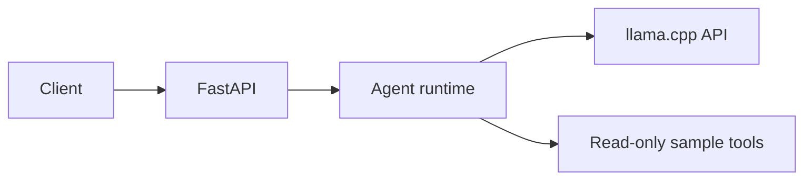

# Local Agent Harness

A local FastAPI sandbox for experimenting with AIOps agents backed by a llama.cpp server. The agent can inspect service health, recent logs, and incident details through bounded, read-only tools.

> The included tools return deterministic sample data from the code. They do not connect to real monitoring, logging, or incident systems. Live evaluations use the configured model, but still use the sample tool data.

## What it includes

- Three orchestration strategies: autonomous, guided, and deterministic.
- Free-text and structured incident report outputs.
- Tool allowlisting, validated inputs, and limits on execution time and tool calls.
- Mock and live evaluation modes.



## Quick start

Requires Python 3.12+, [uv](https://docs.astral.sh/uv/), and a running llama.cpp server with an OpenAI-compatible API.

```sh
make setup
cp .env.example .env
make dev
```

The API listens on `http://127.0.0.1:8000`. For configuration and request options, see [Usage](docs/usage.md).

## Try a request

```sh
curl http://127.0.0.1:8000/agents/run \
  -H 'Content-Type: application/json' \
  -d '{
    "task": "Check payments-api and summarize its recent errors",
    "allowed_tools": ["get_service_health", "get_recent_logs"]
  }'
```

## API

| Method | Endpoint | Purpose |
| --- | --- | --- |
| `GET` | `/health` | Check that the API is running |
| `GET` | `/tools` | List available tools and their schemas |
| `POST` | `/agents/run` | Run an agent task |

Interactive API docs are available at [`/docs`](http://127.0.0.1:8000/docs) while the server is running.

## Evaluations

```sh
make eval-mock
make eval STRATEGY=guided OUTPUT_MODE=prompt_json TRIALS=3
```

Mock evaluations validate harness behavior offline with fixed transcripts and sample data. For live evaluations, start `make dev` first; `make eval` sends each scenario to that API. Both commands print a compact summary and save the full JSON report. See [Evaluations](docs/evaluations.md) for metrics, options, and limitations.

> **Interpreting results:** Mock runs check harness behavior with scripted model responses and sample tool data; they do not measure model quality or tool selection. Live runs use the configured model but still rely on sample tool data. Scores track scenario criteria and output format, not factual correctness: required-fact coverage means a phrase was present, not that the claim is true or supported. Treat results as diagnostics for this setup, not as a model benchmark or evidence of production readiness. Deterministic results come from predefined workflows and are not directly comparable to model-driven strategies for tool-selection quality.

## Development

Run `make check` for linting, formatting, type checks, and tests. See [Usage](docs/usage.md) for setup details and [Evaluations](docs/evaluations.md) for evaluation commands.
